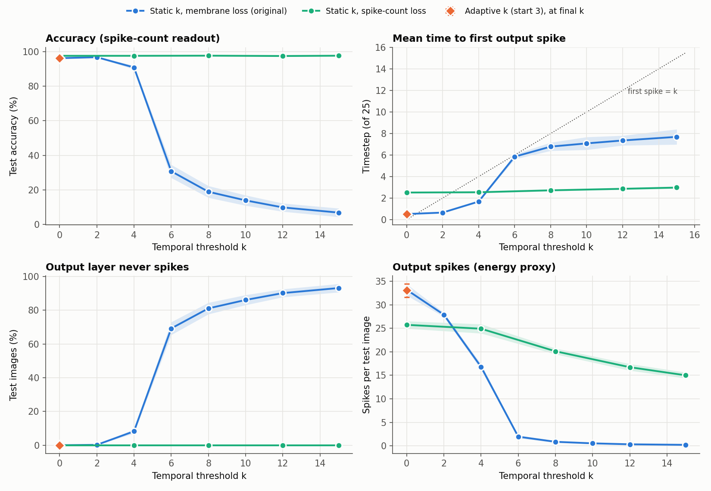
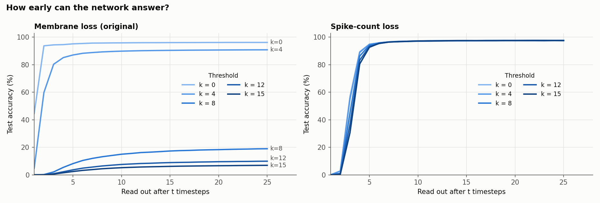
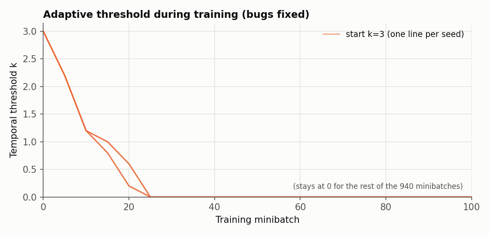

# Spiking Neural Networks — CMPM 118 Collaborative Research in Engineering (UC Santa Cruz)

Coursework and research experiments with spiking neural networks (SNNs) in
[snnTorch](https://snntorch.readthedocs.io/). The main project is a
**temporal-threshold loss** that tries to control *when* a spiking network
commits to an answer, plus a sweep that maps out its trade-offs.

| Folder | What's in it |
|---|---|
| [`temporal_threshold/`](temporal_threshold/) | **Main project.** Temporal-threshold loss, threshold sweep, figures |
| [`eeg/`](eeg/) | Exploratory: spike-encoding real EEG recordings and classifying them with an SNN |
| [`tutorials/`](tutorials/) | snnTorch tutorial follow-alongs (spike encoding, LIF neurons, N-MNIST CSNN) |

---

## Temporal-threshold loss

### Idea

A spiking network runs for `T = 25` timesteps per image, and its output
neurons spike over time. Normally all that matters is *which* neuron spikes
the most. This project adds a term that also shapes *when* the network
spikes: any output spike before timestep `k` is penalised.

```
loss = Σ_t  CE(membrane_t, label)            # usual snnTorch tutorial-5 loss
     + Σ_{t<k} MSE(spikes_t, 0)              # "don't answer before step k"
```

Two schedules for `k`:

* **Static:** `k` is a fixed hyperparameter.
* **Adaptive:** every minibatch, look at the spikes at step `int(k)`. If
  under 60% of them hit the correct class, wait longer (`k += 0.2`). If over
  80%, allow earlier answers (`k -= 0.2`).

Network: 784 → 1000 → 10 fully connected leaky integrate-and-fire neurons
(β = 0.95), direct (non-spiking) pixel input, Adam (lr 5e-4), batch 128,
2 epochs on MNIST, 3 seeds per setting. Evaluation uses the full 10k test set.

### Bug fixes to the original adaptive version

The first adaptive notebook trained up to ~89% and then collapsed to ~20%
before crashing with `ZeroDivisionError`. The idea wasn't at fault; two bugs
in the accuracy check were
([`notebooks/adaptive_threshold.ipynb`](temporal_threshold/notebooks/adaptive_threshold.ipynb)):

```python
if spk_rec[step][image_idx][targets[image_idx]-1] == 1:   # before
```

1. **Off-by-one:** MNIST labels are already 0–9, so `targets - 1` never
   pointed at the correct output neuron. Measured accuracy was **always 0**
   (the log shows `0 correct / 93 spiked` every batch).
2. **Stale index:** `step` was a leftover variable from an earlier loop, so the
   check always looked at the last timestep, not the threshold step.

With accuracy stuck at 0, `k` grew by 0.2 every batch, up to 23 of 25 steps.
The network learned to stop spiking entirely, and the divide-by-zero followed.

### Results

42 training runs (about 1.5 hours on a 4-core laptop CPU): static `k ∈ {0,2,4,6,8,10,12,15}` and the
adaptive schedule with the original loss, plus a spike-count-loss variant at
`k ∈ {0,4,8,12,15}`, each with 3 seeds. Shaded bands show ±1 sd across seeds.



**1. With the original loss, the network learns to go silent instead of waiting.**
`k = 2` is a free win: accuracy goes up slightly (96.2 → 96.7%) and output
spikes go down 16%. From `k = 4` the trade-off turns sharp. At `k = 6`, 69% of
test images produce *no output spike at all*, and spike-count accuracy falls
to 31%. When the network does spike it is almost always right
(first-spike accuracy ≈ overall accuracy). All of the errors come from silence.

**2. The network still knows the answer; it just never says it.** Reading
the class from the output *membrane potential* gives **97.1% at k = 15**,
where spike-count accuracy is 3.7% (seed-0 diagnostic, `results/diag/`). The
cause is the loss. Its classification term is cross-entropy on membrane
potential, which a neuron can win *without ever spiking*. So the cheapest way
to satisfy "no spikes before step k" is to never spike.

**3. Moving cross-entropy onto spike counts fixes the silence.** With
`CE(Σ_t spikes, label)`, staying silent costs the network something.
Accuracy stays at **97.5% for every k**, with 0% silent images. Output spikes
fall 42% (25.7 → 15.0 per image) from k = 0 to k = 15. It also uses about
5× fewer hidden-layer spikes than the membrane loss (≈920 vs ≈4900 per image).
**But the first spike barely moves** (step 2.5 → 3.0). Under this loss the
penalty works as a sparsity regulariser, not as latency control.



**4. The fixed adaptive schedule converges to k = 0.** With the bugs fixed it
trains normally (96.2%, no crash). But its accuracy check is lenient: it asks
whether the correct neuron was *among* those that spiked. That clears the 80%
bar almost immediately, so `k` drops from 3 to 0 within about 25 minibatches
in every seed and the penalty switches off.



Full numbers: [`results/summary.md`](temporal_threshold/results/summary.md).

### Takeaways and next steps

* A loss that shapes spike *timing* has to keep spiking itself rewarded.
  Otherwise "answer later" collapses into "never answer."
* To actually push first-spike time toward `k`, the penalty needs more weight
  relative to the classification term (sweep a coefficient λ), or early output
  spikes should be masked outright.
* The adaptive rule needs a stricter signal, such as "the *first* neuron to spike
  is correct" (first-spike accuracy), so it has something to push against.
* MNIST is fed as constant current (the same image every step), so there's
  little new evidence to wait for. Event-based data such as N-MNIST, where
  information arrives over time, is a better test of whether waiting helps.

### Reproduce

```bash
pip install -r requirements.txt
cd temporal_threshold
python sweep.py                                           # static k grid + adaptive, 3 seeds (~1 h on 4 CPU cores)
python sweep.py --loss-mode count --ks 0 4 8 12 15 --adaptive-k0   # spike-count loss variant
python plot.py                                            # figures + results/summary.md
```

MNIST downloads to `/tmp/data/mnist` (override with the `MNIST_DIR` env var).
Each run saves a JSON in `results/runs/`, and the sweep skips runs that
already exist, so it can be stopped and resumed.

| File | Purpose |
|---|---|
| [`tt.py`](temporal_threshold/tt.py) | Model, both loss variants, static/adaptive schedules, evaluation metrics |
| [`sweep.py`](temporal_threshold/sweep.py) | Runs the grid; one JSON per run |
| [`plot.py`](temporal_threshold/plot.py) | Figures and summary table |
| [`notebooks/`](temporal_threshold/notebooks/) | Original exploratory notebooks. `adaptive_threshold` has the bug fixes. `optuna_sweep` is an earlier search that minimized training loss; it was replaced by the grid because the penalty term grows with `k`, so minimizing loss always favors small `k` |

---

## EEG spike encoding (exploratory)

[`eeg/encode.ipynb`](eeg/encode.ipynb) loads EEG from the
[WAY-EEG-GAL](https://www.nature.com/articles/sdata201447) grasp-and-lift
dataset (`.mat`) and the
[PhysioNet EEG Motor Movement/Imagery](https://physionet.org/content/eegmmidb/1.0.0/)
dataset (`.edf`). It delta-modulates each electrode into ±1 spike trains,
simulates Lapicque and leaky integrate-and-fire neurons on them, and trains
SNN classifiers for rest / left fist / right fist (T0/T1/T2).

**Status: unfinished.** The classifiers don't learn yet: accuracy sits at
50.5% (always predicting the majority class), and the temporal model has a
batch-shape bug. Known issues to fix next:

* Each training example is a single 64-channel time slice, so the model can't see any temporal structure.
* The EDF data is fed in as raw voltages and is never spike-encoded.
* It trains on run R03 (executed movement) and tests on R04 (imagined movement).
* The `spikegen.delta` threshold is set to the median *level* of the signal, but delta coding thresholds the *change*.

Put data in `eeg/data/` (`S001R03.edf`, …, `P1/WS_P1_S9.mat`). Datasets are git-ignored.

## Tutorials

snnTorch tutorial follow-alongs, kept as learning notes:
[`01_spike_encoding.ipynb`](tutorials/01_spike_encoding.ipynb) (rate coding MNIST),
[`02_lif_neuron.ipynb`](tutorials/02_lif_neuron.ipynb) (Lapicque/LIF neuron dynamics), and
[`nmnist_csnn.py`](tutorials/nmnist_csnn.py) (convolutional SNN on event-camera N-MNIST, after snnTorch tutorial 7).

## Credits

Built with [snnTorch](https://github.com/jeshraghian/snntorch) (Eshraghian et al.).
The N-MNIST version of the temporal-threshold experiments was done by collaborator
Shubhi Mishra and lives in the git history (`nminist.ipynb`).
